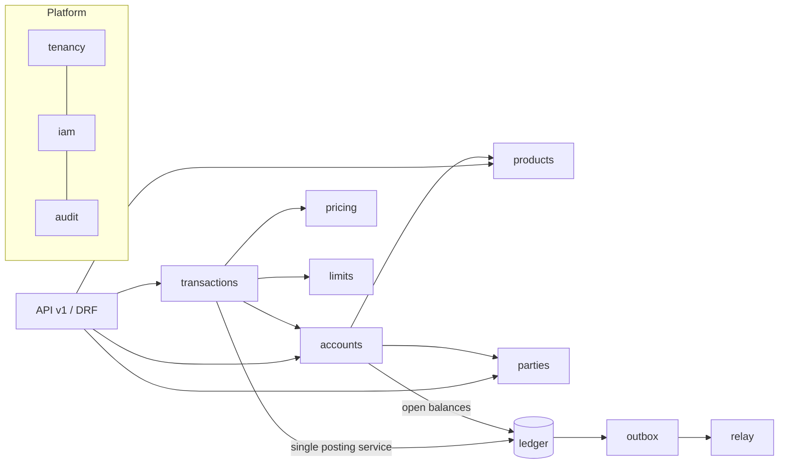

# Next Core — Bank-Grade Lightweight Core Banking System

**Status: MVP track (Phases 3–6 compressed) — first complete, testable version built
2026-11-25; combined gate awaiting reviewer verdicts and human approval.**

Next Core is a modern, lightweight, API-first core banking system designed as real financial
infrastructure. It targets regulated banks, electronic money institutions, fintechs and
microfinance institutions, deployable as multi-tenant SaaS, dedicated SaaS, or on-premise
from **one codebase**. Correctness, accounting integrity, tenant isolation and security take
precedence over speed.

## What it does today

- **Ledger kernel** — double-entry, append-only journal; per-currency balanced entries
  enforced in code *and* by PostgreSQL triggers; balances are projections reconstructable from
  postings (`verify_ledger`); integer minor units only.
- **Product engine** — any deposit, wallet, term-deposit or loan product is a versioned,
  immutable JSON definition: typed parameters with account overrides, fees (flat, percentage,
  tiered, formula), limits (per transaction / daily / monthly), operation guards, interest,
  overdraft & credit lines, lifecycle rules — with a sandboxed expression language (no code
  execution) and maker-checker approval. See
  [`docs/products/product-engine.md`](docs/products/product-engine.md).
- **Parties** (customers, identifiers, KYC outcome), **accounts** (lifecycle, blocks, closure,
  mod-97 numbers), **transactions** (deposits, withdrawals, transfers, holds with partial
  capture, loan disbursement/repayment, four-eyes reversals, dry-run simulation), **interest** accrual
  (day-by-day, value-dated) and capitalization, **EoD** steps, **audit trail** and **transactional outbox**.
- **API v1** — idempotent financial writes (`Idempotency-Key`), RFC 9457 errors, OpenAPI 3.1
  (`/api/schema/openapi.json`). Endpoint list: [`docs/api/api-reference.md`](docs/api/api-reference.md).
- **Multi-tenancy** — database per tenant, explicit tenant context, no default tenant; OIDC
  tokens bound to the tenant's realm; on-premise single-tenant profile without control plane.



## Quickstart (local, real PostgreSQL)

```bash
uv sync
make test-db-start                       # local PostgreSQL 16 on :5433 (no Docker needed)
make check                               # lint + mypy strict + tests + docs
export NEXT_CORE_PROFILE=local DJANGO_SETTINGS_MODULE=next_core.settings.local
uv run python manage.py migrate          # control database
uv run python manage.py migrate_tenants  # every active tenant database
uv run python manage.py bootstrap_tenant # seed chart of accounts + 5 demo products
uv run python manage.py runserver 0.0.0.0:8000
```

Tenants are registered in the control-plane registry (SaaS profiles); API calls need
`X-Tenant-ID` and a bearer token from the tenant's OIDC realm — run Keycloak with
`docker compose --profile iam up`. The full curl walkthrough is in the
[API reference](docs/api/api-reference.md#quickstart-walkthrough-local); the same flow runs
in `tests/e2e/test_api_flows.py`. Operational commands: `relay_outbox`, `verify_ledger`,
`run_eod_steps`.

**Resuming work? Read [`STATUS.md`](STATUS.md) first** — it always holds the current state
and the exact next step.

## Start here

| If you are… | Read |
|---|---|
| Anyone new to the project | [`docs/executive/architecture-overview.md`](docs/executive/architecture-overview.md) |
| Resuming / continuing development | [`STATUS.md`](STATUS.md) |
| Reviewing the approved Phase 0 blueprint | [`docs/executive/phase0-review.md`](docs/executive/phase0-review.md) |
| Looking for the PRD | [`docs/product/prd.md`](docs/product/prd.md) |
| Planning the build | [`docs/product/roadmap.md`](docs/product/roadmap.md) + [`docs/product/development-workflow.md`](docs/product/development-workflow.md) |
| An engineer starting Phase 1+ | [`CLAUDE.md`](CLAUDE.md), then [`docs/architecture/repository-structure.md`](docs/architecture/repository-structure.md) |
| Interested in the ledger design | [`docs/accounting/ledger-architecture.md`](docs/accounting/ledger-architecture.md) |
| Configuring products | [`docs/products/product-engine.md`](docs/products/product-engine.md) |
| Integrating with the API | [`docs/api/api-reference.md`](docs/api/api-reference.md) |

## Documentation map

```text
docs/
  executive/      Architecture overview, Phase 0 review summary
  product/        PRD, scope, roadmap & acceptance gates, development workflow, capacity model
  architecture/   C4 diagrams, tenancy & deployment, idempotency & concurrency, repo structure
  domain/         Glossary, domain model & bounded contexts, transaction lifecycle
  accounting/     Ledger architecture (as built), accounting model, invariants + evidence, balance semantics, CoA
  products/       Product engine reference (definition schema, expression language, seed catalog)
  api/            API reference, API standards, error catalog, OpenAPI document
  events/         Event standards, outbox envelope & event catalog (webhook delivery: OD-30)
  security/       Threat model, security architecture, authorization matrix, control readiness
  deployment/     Environment reference (authored); SaaS/on-premise guides (skeleton — Phase 9+)
  operations/     Observability & operations (skeleton — Phase 9+)
  runbooks/       Operational runbooks (skeleton — Phase 9+)
  testing/        Test strategy
  migrations/     Data & schema migration strategy (skeleton — Phase 1+)
  decisions/      ADRs, BLNK adoption matrix, open-decisions register
```

Documents marked *(skeleton)* have their structure and per-section guidance in place; content is
authored in the phase that owns them. **Documentation is part of the Definition of Done** and is
updated in the same change as the code it describes.

## Technology position (summary — see ADRs for rationale)

- **Modular monolith first** with strict bounded contexts ([ADR-0001](docs/decisions/adr/0001-modular-monolith.md))
- **Python / Django / Django REST Framework** as the primary framework ([ADR-0002](docs/decisions/adr/0002-django-primary-framework.md))
- **PostgreSQL** as the sole authority for all financial state ([ADR-0003](docs/decisions/adr/0003-postgresql-authority.md))
- **Integer minor units** for money — never floating point ([ADR-0004](docs/decisions/adr/0004-money-representation.md))
- **Database-per-tenant** isolation for regulated financial data ([ADR-0005](docs/decisions/adr/0005-multi-tenancy-model.md))
- External IAM (Keycloak reference implementation), OAuth 2.0 / OIDC ([ADR-0008](docs/decisions/adr/0008-external-iam.md))
- **Declarative product engine** with a restricted expression language — no tenant code execution ([ADR-0010](docs/decisions/adr/0010-declarative-product-engine.md), proposed)

## Implementation phases

| Phase | Deliverable | Status |
|---|---|---|
| 0 | Architecture blueprint & PRD | ✅ Approved 2026-07-18 |
| 1 | Repository & engineering foundation | ✅ Approved 2026-07-18 |
| 2 | Tenancy, IAM & audit foundation | ✅ Approved 2026-11-25 |
| 3 | Ledger kernel | 🔨 MVP track — built, gate pending |
| 4 | Parties, products & customer accounts | 🔨 MVP track — built, gate pending |
| 5 | Transfers, holds, fees & limits | 🔨 MVP track — built (webhooks deferred), gate pending |
| 6 | Posting rules & product configurability | 🔨 MVP track — built (ADR-0010 proposed), gate pending |
| 7 | Reconciliation & business-day operations | Partial pre-build (EoD steps) |
| 8 | Interest & advanced account capabilities | Partial pre-build (interest, term deposits) |
| 9 | Production hardening | — |
| 10 | Reference deployments & release candidate | — |

Each phase ends at an explicit **acceptance gate** requiring human review. See
[`docs/product/roadmap.md`](docs/product/roadmap.md).

## How this project is developed

This project is developed with Claude Code following a strict, gated working method described in
[`docs/product/development-workflow.md`](docs/product/development-workflow.md). Project-wide rules
live in [`CLAUDE.md`](CLAUDE.md); context-specific rules in [`.claude/rules/`](.claude/rules/);
specialized review subagents in [`.claude/agents/`](.claude/agents/); workflow commands in
[`.claude/commands/`](.claude/commands/).

## License

Proprietary — all rights reserved (to be finalized; see open-decisions register).
