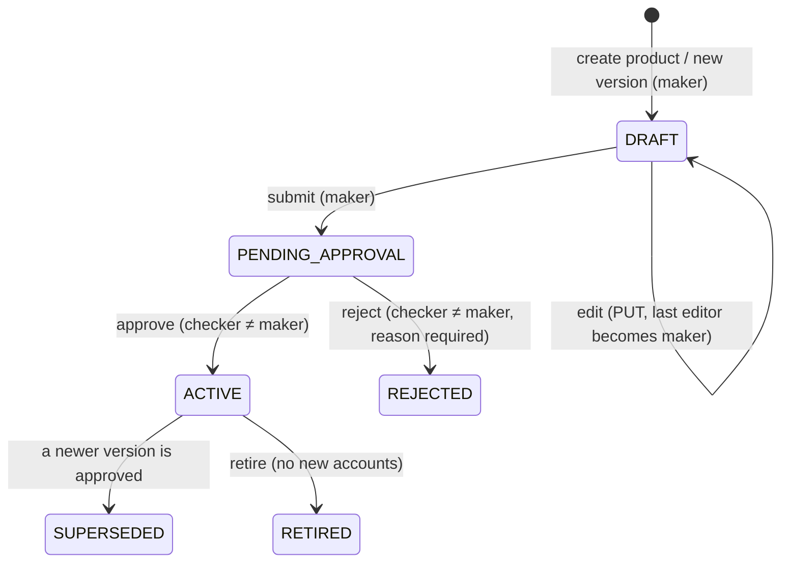

# Product Engine — Declarative Financial Products

| | |
|---|---|
| **Purpose** | Reference for the product engine: concepts, versioning & maker-checker, the definition schema v1, the restricted expression language, fees, limits, operation rules, interest, credit/overdraft, lifecycle, ledger mapping, and the seed catalog. |
| **Audience** | Product managers / product approvers, engineering, API integrators, auditors. |
| **Owning phase** | MVP track (Phases 4 + 6 compressed, built 2026-11-25). Must match `src/next_core/products/` (same-change rule). |
| **Related** | [ADR-0010](../decisions/adr/0010-declarative-product-engine.md) · [API reference](../api/api-reference.md) · [Accounting model](../accounting/accounting-model.md) · [Chart of accounts](../accounting/chart-of-accounts.md) · [Transaction lifecycle](../domain/transaction-lifecycle.md) · OD-11, OD-31..OD-35 |

## Position

Every financial product — current account, savings, term deposit, e-money wallet, loan — is
**configuration, not code**. A product version carries one JSON *definition document* that is
validated into immutable typed objects (`products/definition.py`) and interpreted by the
transactions orchestrator at run time. Adding or changing a product never requires a deploy.

Design lineage: the configuration-first catalog of **Mambu** (typed product parameters with
account-level overrides inside bounds) and the "product as a contract over the ledger" idea of
**Thought Machine**. Thought Machine-style *executable* product code (tenant-supplied Python) is
deliberately excluded: no tenant-supplied code is ever executed. Where logic is needed (fee
formulas, guards), a small **restricted expression language** is interpreted by a whitelist
evaluator — see [ADR-0010](../decisions/adr/0010-declarative-product-engine.md).

## Concepts

| Concept | Meaning |
|---|---|
| **Product** | Catalog entry: unique `code` per tenant, `name`, `description`, `category` (fixed across versions). |
| **Product version** | Numbered (1, 2, …) definition document + SHA-256 `definition_hash` of its canonical JSON. |
| **Account pinning** | An account stores the `product_version_id` in force at opening; it keeps that version forever (DB trigger refuses changes). Business transactions record the version used (`product_versions`). This is invariant 21. |
| **Parameter override** | Per-account value of a parameter declared `overridable`, validated against the parameter's `min`/`max`. |

### Version lifecycle



- At most **one ACTIVE** and **one open (DRAFT or PENDING_APPROVAL)** version per product
  (partial unique indexes `pv_one_active`, `pv_one_open`).
- Activation happens **at approval**; `effective_from` is set to the business date of
  approval. Future-dated activation is not implemented (OD-33).
- New accounts open on the ACTIVE version. SUPERSEDED and RETIRED versions stay resolvable for
  the accounts pinned to them.

### Maker-checker (enforced server-side, three layers)

1. **Application** (`products/application.py`): `approve` / `reject` refuse when the acting
   principal equals the version's `submitted_by` or `created_by` → `403 MAKER_CHECKER_VIOLATION`.
2. **Permissions**: approve/reject/retire need `products:approve`; create/edit/submit need
   `products:write`. Default bundles separate them (`product_manager` vs `product_approver`).
   A principal holding both roles is still blocked by layer 1.
3. **Database**: CHECK `pv_maker_checker` (approved_by ≠ submitted_by and ≠ created_by) and
   CHECK `pv_active_requires_approval`; trigger `product_version_guard` makes the definition
   immutable once a version leaves DRAFT, makes approval evidence immutable once ACTIVE /
   SUPERSEDED / RETIRED, and refuses deletion of non-draft versions.

Every step (`product.version.drafted|edited|submitted|approved|rejected`, `product.retired`)
writes an audit event; activation emits `product.version.activated` through the outbox.

The provisioning command `bootstrap_tenant` activates the seed catalog through the same
submit/approve path with two distinct system principals (`system:bootstrap-maker`,
`system:bootstrap-checker`), so the DB CHECK still holds.

## Definition schema v1 — reference

All money values are **per-currency maps in wire format** (ADR-0004): decimal strings with at
most the currency's exponent, e.g. `{"MRU": "50.00", "XOF": "750", "EUR": "1.25", "USD": "1.25"}`.
A map must cover **every** currency listed in `currencies` and nothing else. Rates are decimal
strings (`"0.0125"`), never JSON numbers. Validation reports **all** field errors at once in
`errors[]` of a `400 VALIDATION_ERROR` (paths like `fees[0].calculation.rate`).

**Resource bounds** (checked before parsing, `MAX_*` in `products/definition.py`): serialized
document ≤ 64 KiB; JSON nesting depth ≤ 8; ≤ 50 items in each of `fees`, `limits`,
`operation_rules` and `parameters`; ≤ 20 tiers per tiered fee. Violations → `400
VALIDATION_ERROR`.

| Field | Type | Required | Rules |
|---|---|---|---|
| `schema_version` | int | no (default 1) | Only `1` is supported. |
| `category` | enum | yes | `CURRENT_ACCOUNT`, `SAVINGS`, `TERM_DEPOSIT`, `WALLET`, `LOAN`, `INTERNAL`. Cannot change across versions. |
| `balance_side` | enum | yes | `LIABILITY` (deposits; the customer principal ledger balance is credit-normal) or `ASSET` (lending; debit-normal). |
| `currencies` | list | yes | Non-empty, unique, supported ISO-4217 codes (`MRU`, `XOF`, `EUR`, `USD`, `TND`). |
| `gl_mapping` | object | yes | Role → GL account code. Required roles: `principal`, `cash`, `fee_income`, `tax_payable`. Optional: `accrued_interest`, `interest_expense`, `interest_income`. Unknown roles rejected. At approval every code must exist and be active, and **every role is type-checked**: `principal` and `accrued_interest` = the product side (LIABILITY or ASSET); `cash` = ASSET; `fee_income`, `interest_income` = INCOME; `interest_expense` = EXPENSE; `tax_payable` = LIABILITY. A mismatch is a `400 VALIDATION_ERROR` at approval. |
| `parameters` | object | no | Name (Python identifier, ≤ 40 chars) → parameter spec (below). |
| `allowed_operations` | list | yes | Non-empty subset of `DEPOSIT`, `WITHDRAWAL`, `TRANSFER_OUT`, `TRANSFER_IN`, `HOLD`, `DISBURSEMENT`, `REPAYMENT`. LIABILITY products may not allow `DISBURSEMENT`/`REPAYMENT`; ASSET products allow **only** those two. |
| `operation_rules` | list | no | Guards (below). Codes unique. |
| `fees` | list | no | Fee rules (below). Codes unique. |
| `limits` | list | no | Limit rules (below). Codes unique. |
| `interest` | object | no | Interest configuration (below). |
| `overdraft_parameter` | string | no | Names a declared `money` parameter. LIABILITY products only. |
| `credit_limit_parameter` | string | ASSET: yes | Names a declared `money` parameter. Required for ASSET products, refused for LIABILITY products. |
| `lifecycle` | object | no | Lifecycle rules (below). |

### Parameters

| Field | Type | Rules |
|---|---|---|
| `type` | enum | `money` (per-currency map), `rate` (decimal string, −1..10), `integer`, `boolean` |
| `default` | per type | Required; must satisfy `min`/`max`. |
| `min`, `max` | per type | Optional bounds (money: per currency). |
| `overridable` | bool | Default `false`. Only overridable parameters accept account-level `parameter_overrides`. |
| `description` | string | ≤ 200 chars. |

Account-level overrides are sent at opening (`parameter_overrides`): money as a single decimal
string in the account currency (`"500.00"`), rates as decimal strings, integers and booleans
as JSON values. Unknown/non-overridable names → `not_overridable`; out-of-bounds →
`out_of_bounds` (both in `errors[]`). Validated overrides are stored on the account and are
immutable afterwards (changing them is not exposed in the MVP).

### Operation rules (guards)

```json
{"code": "LOCKED_UNTIL_MATURITY", "operations": ["WITHDRAWAL", "TRANSFER_OUT"],
 "condition": "days_to_maturity <= 0", "message": "Funds are locked until the maturity date."}
```

For each operation, every rule listing it is evaluated; the condition must be **true** for the
operation to proceed, otherwise `422 PRODUCT_RULE_VIOLATION` with `message` as `detail` and
`rule` = code. An evaluation error is also a `PRODUCT_RULE_VIOLATION`.

### Fees

| Field | Rules |
|---|---|
| `code` | 1–40 chars `[A-Za-z0-9_]`, stored upper-case. |
| `operations` | Operations that trigger the fee. |
| `calculation.type` | `FLAT` (`amount` map) · `PERCENTAGE` (`rate` 0..1, optional `min`/`max` maps) · `TIERED` (`tiers`) · `EXPRESSION` (`formula`). |
| `condition` | Optional expression; fee is skipped when false. |
| `tax_rate` | Rate 0..1, default `"0"`. |
| `rounding` | `HALF_EVEN` (default), `HALF_UP`, `UP`, `DOWN`. |
| `description` | ≤ 200 chars. |

Semantics (`pricing/fees.py`, deterministic — same inputs, same outputs):

- The computed figure is the **net fee** (credited to the `fee_income` GL). **Tax is charged on
  top**: `tax = net × tax_rate`, quantized once with the rule's rounding, credited to
  `tax_payable`. The account is debited `net + tax` (OD-34).
- `PERCENTAGE`: `net = amount_minor × rate`, quantized once, then clamped to `[min, max]`.
- `TIERED`: **volume tiers** — the first tier whose `up_to` covers the amount applies to the
  *whole* amount (`flat` map or `rate`). Exactly one of `flat`/`rate` per tier; bounds strictly
  increasing per currency; only the last tier is open-ended (`"up_to": null`) and it must be.
- `EXPRESSION`: formula evaluated in **major units**, quantized with the rule's rounding. A
  negative result → `PRODUCT_RULE_VIOLATION`.
- All fee arithmetic (`net`, `tax`) runs at 50-digit decimal precision and is quantized
  **once**, so no double rounding occurs on ties.
- Fees computing to zero are omitted. Fees are posted as separate journal entries
  (purpose `FEE<D|C><n>:<code>`) in the same DB transaction as the principal, and are mirrored
  by a reversal.
- Which account pays: each leg is evaluated against **its own** product — in a transfer the
  source is evaluated for `TRANSFER_OUT`, the target for `TRANSFER_IN`; a loan disbursement
  evaluates the loan for `DISBURSEMENT` (fee charged to the loan, i.e. it increases the
  outstanding principal) and the target for `TRANSFER_IN`.

### Limits

| Field | Rules |
|---|---|
| `code`, `operations` | As for fees. |
| `window` | `TRANSACTION` (per operation), `DAILY` (business date), `MONTHLY` (calendar month of the business date). |
| `max_amount` | Optional money map. |
| `max_count` | Optional positive integer; not allowed on `TRANSACTION` windows. |

At least one of `max_amount` / `max_count`. Windowed limits are consumed **atomically**
(`limits/application.py`): counter rows keyed by (account, limit code, currency, window key
`D2026-11-25` / `M2026-11`) are created with `INSERT … ON CONFLICT DO NOTHING`, locked with
`SELECT … FOR UPDATE` in (code, window) order **after** the account row lock and before the
ledger balance locks, checked and incremented in the same DB transaction as the posting. Breach
→ `422 LIMIT_EXCEEDED` with `limit: {code, window}`. Holds consume limits at placement.
Consumption is not refunded on reversal (OD-32). Current usage: `GET /api/v1/accounts/{id}/limits`.

### Interest

| Field | Rules |
|---|---|
| `rate_parameter` | Required; names a declared `rate` parameter (annual nominal rate). |
| `day_count` | `ACT_365` (default), `ACT_360`, `ACT_ACT` (365/366 by year of the accrual date). |
| `capitalization` | `MONTHLY` (default), `AT_MATURITY`, `NONE`. |
| `minimum_balance` | Money map; no accrual below it (default 0). |
| `rounding` | Default `HALF_EVEN`. |

Requires `gl_mapping.accrued_interest`, plus `interest_expense` (LIABILITY) or
`interest_income` (ASSET). An account of such a product gets a second ledger balance with
purpose `ACCRUED_INTEREST` mapped to `accrued_interest`.

- **Daily accrual** (`pricing/interest.py`): `basis × rate / days_in_year`, computed at
  50-digit precision and quantized **once per day** to minor units (no sub-minor carry —
  OD-31); zero when the basis is ≤ 0, below `minimum_balance`, or the rate is ≤ 0.
- **Basis = value-dated book balance**: the principal book balance *as of the accrual day*,
  recomputed from postings whose entry `value_date` ≤ that day
  (`ledger.application.book_balance_as_of`) — never today's projection. A deposit value-dated
  later does not inflate earlier days.
- **Day-by-day, checkpointed, never in the future**: each account carries
  `interest_accrued_through`. A run for date *D* accrues every day from the checkpoint + 1
  (or the opening date) through *D*, in order, then advances the checkpoint in the same DB
  transaction; at most 400 days per run (`CONFLICT_STATE` beyond — catch up in several runs).
  *D* after the current business date is refused (`400 VALIDATION_ERROR`). Accrual stops the
  day **before** the maturity date. Each accrual transaction and entry carries
  `value_date` = the accrual day.
- **Ledger legs**: the accrued balance grows on its normal side; the P&L counterpart takes the
  other side — LIABILITY: DR `interest_expense` / CR accrued interest payable; ASSET:
  DR accrued interest receivable / CR `interest_income`.
- **Capitalization** moves accrued interest into principal (decrease accrued, increase
  principal) on each **due date**: `MONTHLY` = every 1st of a month after opening;
  `AT_MATURITY` = the maturity date; `NONE` never. For due date *d* the amount is the
  accrued figure with `value_date < d` (never early), *d* is processed only once accrual has
  run through *d - 1*, and the entry's `value_date` is *d*. A per-account checkpoint
  (`interest_capitalized_through`) makes it resumable: missed due dates are caught up **in
  order**, and during an accrual catch-up the due capitalizations are applied in date order
  before the next day accrues (compounding is never skipped). At or after maturity the gate
  is "accrual has run through *maturity - 1*" (accrual stops there), so `AT_MATURITY` never
  capitalizes a partial figure. A `MONTHLY` policy keeps running after maturity if a product
  combines it with a term (the seed term deposit uses `AT_MATURITY`). Never for a future
  business date. Evidence: `test_monthly_capitalization_catches_up_in_order_and_never_early`,
  `test_term_deposit_rules_and_interest`.
- A run during the day uses the intra-day balance for *today* — run EoD after the day is
  closed (OD-45).
- Runs per account in its own DB transaction with a **deterministic business-transaction id**
  (UUIDv5 of tenant, account, date, kind), so re-running a date is a no-op
  (`run_eod_steps` command, `POST /api/v1/operations/eod`).

### Overdraft and credit line

- **Overdraft** (LIABILITY): the account's principal ledger balance carries
  `overdraft_limit` = the parameter value (after override); funds checks use
  `available = book − held − pending_debit + overdraft_limit` under row lock, with a DB trigger
  backstop.
- **Credit line** (ASSET): a disbursement is refused with `CREDIT_LIMIT_EXCEEDED` when
  `outstanding + amount + fees charged to the loan > credit_limit`. A repayment larger than the
  outstanding principal is refused with `AMOUNT_EXCEEDS_OUTSTANDING`. Loan balances are not
  funds-enforced in the ledger sense.

### Lifecycle

| Field | Default | Effect |
|---|---|---|
| `min_kyc_level` | 1 | Opening refused with `KYC_LEVEL_INSUFFICIENT` when the party's `kyc_level` (0–3) is lower. |
| `min_opening_amount` | 0 per currency | Enforced on the **first deposit** (balance never posted to) → `PRODUCT_RULE_VIOLATION` rule `MIN_OPENING_AMOUNT`. |
| `allow_close_with_balance` | false | When false, closure needs every account balance's book figure at zero (and no holds/pending). |
| `term_parameter` | — | Names an `integer` parameter (days); sets `maturity_date = opening date + days`. |
| `dormancy_days` | — | Validated and stored; no automatic dormancy sweep yet. |

## Restricted expression language

Used by `operation_rules[].condition`, `fees[].condition` and `EXPRESSION` fee formulas
(`products/expressions.py`). Expressions are parsed with Python's `ast` parser and **interpreted
by a whitelist evaluator** — nothing is passed to `eval`/`exec`/`compile` for execution.

| Allowed | Refused (compile-time `invalid_expression`) |
|---|---|
| Literals: integers, decimals, strings, `True`/`False` | Attribute access (`a.b`), subscripts (`a[0]`) |
| Declared variable names (table below) | Any call other than `min`, `max`, `abs`; keyword arguments |
| `+ - * /`, unary `-`/`+` | `**`, `%`, `//`, bit operators |
| `== != < <= > >=` (chained), `in` / `not in` a literal list | Lambdas, comprehensions, assignments, f-strings, `None` |
| `and`, `or`, `not`, `x if cond else y` | Unknown variable names |
| `min(...)`, `max(...)`, `abs(x)` (positional args) | |

Bounds: ≤ 500 characters, ≤ 120 AST nodes; each numeric literal ≤ 24 significant digits with
|exponent| ≤ 18 (compile time). Numbers are `Decimal` built from the literal's **source text**
(`0.1` is exactly 0.1 — a float never exists); arithmetic runs with 34-digit precision in a
context bounded to exponents ±30, and **every** decimal signal (division by zero, invalid
operation, overflow, …) becomes a typed `ExpressionError` — never a crash. Type rules: arithmetic needs numbers;
logical operators need booleans; comparisons need same-typed operands; strings and booleans
support only `==`/`!=`. Conditions must yield a boolean, formulas a number.

**Variables** (all amounts in major units of the operation currency):

| Name | Meaning |
|---|---|
| `amount` | Operation amount |
| `currency` | ISO code (string) |
| `operation` | Operation name, e.g. `"WITHDRAWAL"` |
| `channel` | Request channel (`API` default; e.g. `BRANCH`) |
| `kyc_level` | Party KYC level 0–3 |
| `account_age_days` | Calendar days from opening date to the current business date |
| `days_to_maturity` | Days until maturity; `-1` when the account has none |
| `book_balance`, `available_balance` | Principal ledger balance figures before the operation |
| `param_<name>` | Every declared parameter (override applied; money in major units) |

Example: `kyc_level >= 1 or book_balance + amount <= param_tier0_max_balance`.

**Runtime failures** (an approved formula that overflows or fails to evaluate) surface as
`422 PRODUCT_RULE_VIOLATION` naming only the rule/fee code; the expression source and the
underlying error are logged server-side and **never** echoed to API clients.

## How a product meets the ledger

| Definition element | Ledger effect |
|---|---|
| `balance_side` | Funds enforcement on the principal balance: LIABILITY → enforced; ASSET → not enforced (credit-limit check instead). Normal side comes from the mapped GL account type. |
| `gl_mapping.principal` | GL account of the account's `PRINCIPAL` ledger balance (subledger). |
| `gl_mapping.cash` | Internal balance debited on deposits / credited on withdrawals. |
| `fee_income`, `tax_payable` | Internal balances credited by fee entries. |
| `accrued_interest` + `interest_expense` / `interest_income` | `ACCRUED_INTEREST` balance and P&L counterpart. |

Operations map to postings (one balanced entry per purpose, all in one DB transaction):

| Operation | Principal entry |
|---|---|
| Deposit | DR cash (asset) / CR account principal |
| Withdrawal | DR account principal / CR cash |
| Transfer | DR source principal / CR target principal |
| Loan disbursement | DR loan principal (asset ↑) / CR target deposit principal |
| Loan repayment | DR source deposit principal / CR loan principal (asset ↓) |
| Hold | No entry — `held_amount` on the principal balance increases |
| Hold capture | DR held account / CR target; the whole hold is released in the same call |

## Seed catalog (`products/catalog.py`, activated by `bootstrap_tenant`)

Seed money amounts are derived from EUR-equivalent units with factors MRU ×40, XOF ×600,
EUR ×1, USD ×1.

| Code | Category / side | Currencies | Highlights |
|---|---|---|---|
| `CURRENT` | CURRENT_ACCOUNT / LIABILITY (GL 2110) | MRU XOF EUR USD | Overridable `overdraft_limit` (0..5000 EUR-eq.); withdrawal fee flat 0.50 EUR-eq. + 16 % tax; transfer fee 0.5 % (min 0.10, max 10 EUR-eq.) + 16 % tax, skipped when `channel == 'BRANCH'`; `DAILY_OUT` 10 000 EUR-eq. / 50 ops; KYC ≥ 1 |
| `SAVINGS` | SAVINGS / LIABILITY (GL 2120) | MRU XOF EUR USD | 3 % (overridable 0–8 %), ACT/365, monthly capitalization, min accrual balance 10 EUR-eq.; 4 outflows per month; first deposit ≥ 20 EUR-eq. |
| `TERM_DEPOSIT` | TERM_DEPOSIT / LIABILITY (GL 2130) | MRU XOF EUR USD | 5 %, `term_days` 180 (overridable 30–1825) → maturity; rules `LOCKED_UNTIL_MATURITY`, `SINGLE_FUNDING`; capitalization at maturity; first deposit ≥ 500 EUR-eq. |
| `WALLET` | WALLET / LIABILITY (GL 2140) | MRU XOF | KYC 0 allowed; `KYC0_BALANCE_CAP` (8 000 MRU / 120 000 XOF unless KYC ≥ 1); tiered P2P fee (free ≤ 200 MRU, 1 % ≤ 4 000 MRU, flat 50 MRU above; rounding UP); cash-out fee `max(amount * 0.015, 5)`; per-transaction and daily caps |
| `PERSONAL_LOAN` | LOAN / ASSET (GL 1300) | MRU XOF EUR USD | Overridable `credit_limit` (default 1 000 EUR-eq.); 12 % ACT/360, monthly capitalization (accrued receivable GL 1310, income GL 4200); 1 % origination fee (min 1 EUR-eq.); KYC ≥ 2 |

## Worked example — create, approve, simulate

```json
POST /api/v1/products
{
  "code": "YOUTH_SAVER",
  "name": "Youth saver",
  "definition": {
    "schema_version": 1,
    "category": "SAVINGS",
    "balance_side": "LIABILITY",
    "currencies": ["MRU"],
    "gl_mapping": {"principal": "2120", "cash": "1010", "fee_income": "4100",
                   "tax_payable": "2400", "accrued_interest": "2150",
                   "interest_expense": "5100"},
    "parameters": {
      "interest_rate": {"type": "rate", "default": "0.0400", "min": "0", "max": "0.0600",
                        "overridable": true}
    },
    "allowed_operations": ["DEPOSIT", "WITHDRAWAL", "TRANSFER_IN"],
    "operation_rules": [
      {"code": "NO_SMALL_CASH_OUT", "operations": ["WITHDRAWAL"],
       "condition": "amount >= 100", "message": "Minimum withdrawal is 100.00 MRU."}
    ],
    "fees": [
      {"code": "EARLY_WITHDRAWAL", "operations": ["WITHDRAWAL"],
       "condition": "account_age_days < 90",
       "calculation": {"type": "PERCENTAGE", "rate": "0.01", "min": {"MRU": "10.00"}},
       "tax_rate": "0.16"}
    ],
    "limits": [
      {"code": "MONTHLY_OUT", "operations": ["WITHDRAWAL"], "window": "MONTHLY",
       "max_amount": {"MRU": "20000.00"}, "max_count": 2}
    ],
    "interest": {"rate_parameter": "interest_rate", "day_count": "ACT_365",
                 "capitalization": "MONTHLY", "minimum_balance": {"MRU": "0.00"}},
    "lifecycle": {"min_kyc_level": 1, "min_opening_amount": {"MRU": "500.00"}}
  }
}
```

Then (different principals): `POST …/versions/1/submit` (maker) →
`POST …/versions/1/approve` (checker). Before submitting, `POST /api/v1/products/validate`
checks a document without side effects; after activation,
`POST /api/v1/products/{id}/simulate` with
`{"operation": "WITHDRAWAL", "amount": "1000.00", "currency": "MRU", "account_age_days": 10}`
returns the rule results (`allowed`), the fees (`EARLY_WITHDRAWAL` 10.00 + 1.60 tax) and the
applicable limits — without touching any account. `POST /api/v1/transactions/simulate` dry-runs
an operation against a real account (same locks and checks, always rolled back).

## Not in the MVP

Future-dated activation (OD-33), migrating existing accounts to a newer version, editing
account overrides after opening, automatic dormancy, amortization schedules / instalment
plans, cross-currency products (OD-38), withholding tax on interest.
